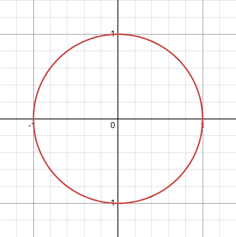
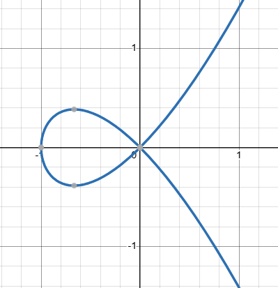
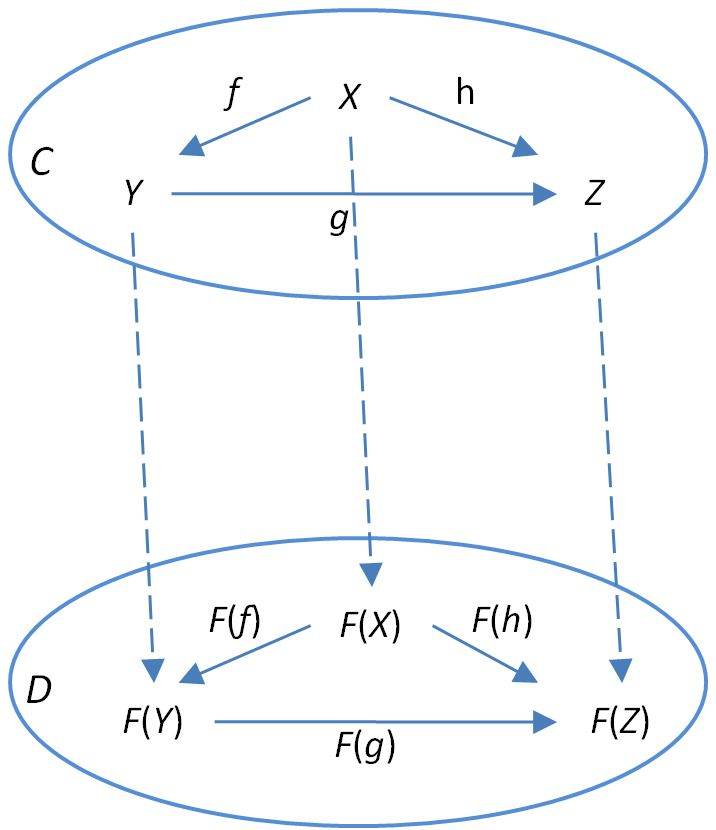
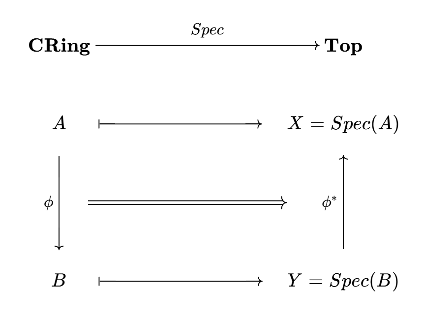
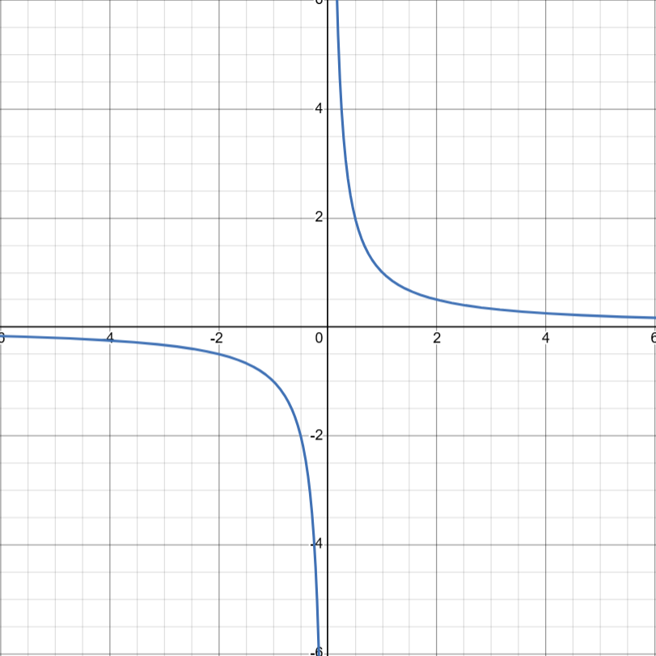
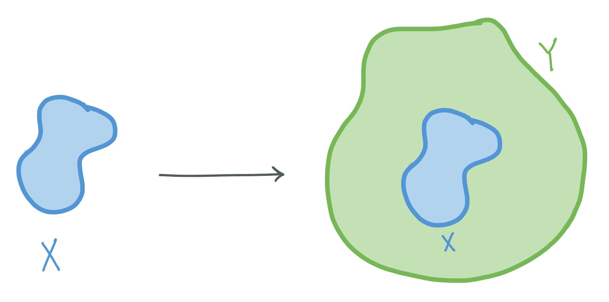

*This post is meant to be a more readable, and hopefully more accessible, version of the presentation I gave in Spring 2025 as part of UCLA's Directed Reading Program (the original slides are posted on their [website](https://sites.google.com/g.ucla.edu/uclamathdrp/resources/past-projects?authuser=0)) after working my way through the first few chapters of Atiyah-MacDonald. I hope that even non-math people will be able to follow the concepts in this post -- don't worry about the technical bits. Finally, thank you to my mentor, Joshua Enwright!*

![Mumford's Treasure Map depicting $Spec(\mathbb{Z}[x])$](mumford.png){#0-mumford width=500 fig-align="center"}

# In This Post

We will of course begin by covering what commutative algebra is and why we want to study it -- in short, it's a tool for algebraic geometry. This brings us to the central question, which asks how to associate geometric things to algebraic things. Section 2 covers the definitions of the mathematical objects we'll be discussing in both mathematical and plain/hand-wavy terms. In Section 3 we make progress towards answering our central question by building a particular geometric object called the prime spectrum and then we observe some of its strange properties. This answers a big part of our question -- given an algebraic thing, we can build a corresponding geometric thing. However, what makes this construction truly meaningful is the nature and strength of this correspondence. Section 4 describes the correspondence in more precise terms, bringing us to the main idea: an equivalence of categories between algebra and geometry.

I tried to make this post accessible for a wide range of backgrounds -- I'd suggest that you read however deeply as is interesting to you and *skip the boring parts*! It is not necessary to understand the definitions or proofs I give, but it would probably be helpful to look up a few words that I don't officially define (*polynomial, commutative, topology,* etc.) if you're not familiar.

- [1. What is Commutative Algebra?](#1-what-is)
    - [1.1 Why study it?](#11-why-study)
    - [1.2 Central Question](#12-central-question)
- [2. Rings and Ideals](#2-rings-and-ideals)
    - [2.1 Definitions](#21-definitions)
    - [2.2 Operations on Ideals](#22-operations)
- [3. The Prime Spectrum and the Zariski Topology](#3-spec-zariski)
    - [3.1 Construction](#31-construction)
    - [3.2 Verification](#32-verification)
    - [3.3 Open Sets in the Zariski Topology](#33-open-sets)
    - [3.4 Properties](#34-properties)
- [4. Functoriality](#4-functoriality)
    - [4.1 A Little Detour into Category Theory](#41-detour)
    - [4.2 Hom(e)omorphisms](#42-morphisms)
    - [4.3 Quotients & Closed Sets](#43-quotient-closed)
    - [4.4 Localizations & Open Sets](#44-localization-open)
    - [4.5 Reflections](#45-reflections)

# 1. What is Commutative Algebra? {#1-what-is}

Commutative algebra is the study of commutative rings and their ideals, modules, and algebras. In layman's terms, it is the study of sets in which the elements can be added and multiplied, and the multiplication is commutative (i.e. $a\cdot b=b\cdot a$). The most familiar examples are the integers $\mathbb{Z}$ and the real numbers $\mathbb{R}$. Another important example is the ring of polynomials in $n$ variables $k[x_1, \ldots, x_n]$ over a field $k$.

### 1.1 Why study it? {#11-why-study}
- We want to understand the operations of addition and multiplication in a general setting

- Commutative rings show up in a lot of places -- the definition is pretty general, so by studying arbitrary commutative rings, we learn about the objects we care about in many different areas of math. For example, number theory is all about studying the integers, while algebraic geometry focuses on polynomial rings. We need commutative algebra as a tool to understand both of these.

### 1.2 Central Question {#12-central-question}
I wanted to study commutative algebra for my DRP because I was interested in algebraic geometry. So this project is motivated by the endeavor to understand the associations between geometric things (living in [topological spaces](https://en.wikipedia.org/wiki/Topological_space)) and algebraic objects. Think of graphing a function: the function itself is the *algebraic* data and the graph of it is the *geometric* representation.   

Given any topological space $X$, there is one piece of low-hanging algebraic fruit: the ring of *real-valued continuous functions* on $X$, $C(X) :=$ {continuous functions $f: X \rightarrow \mathbb{R}$}. In other words, there is naturally a ring associated to $X$. $C(X)$ is a ring because the functions can be added and multiplied point-wise (i.e., adding/multiplying the outputs of the functions, which are real numbers, at each point). So, for each topological space, we always have a corresponding commutative ring whose elements are continuous functions on it.

Our natural next question is the converse: *Given an arbitrary commutative ring, can we associate a topological space to it such that the elements of this ring are continuous functions on that space?* 

When we begin to think about this question, we should notice that there are some examples that have an obvious answer. For example, consider the ring of polynomials in two variables over the real numbers, $\mathbb{R}[x, y]$. We can associate to this ring the real[^1] plane $\mathbb{R}^2$ (with the standard topology), and the elements of $\mathbb{R}[x, y]$ are continuous functions on $\mathbb{R}^2$. This should be our starting point -- what is the connection between the geometric structure of $\mathbb{R}^2$ and the algebraic structure of $\mathbb{R}[x, y]$? One observation to make is that the "zero sets" of polynomials define points and curves -- *geometric objects* living in $\mathbb{R}^2$.

::: {layout-ncol=2}

:::

# 2. Rings and Ideals {#2-rings-and-ideals}

### 2.1 Definitions {#21-definitions}
This is where we begin to get technical. Feel free to follow along to whatever degree you want -- I will try explain the constructions later on in both a technical and a more intuitive way.

**Definition:** A *ring* is a set $A$ equipped with two binary operations, addition and multiplication, such that:  
    &emsp;(i) $(A, +)$ is an abelian group with identity element $0$.  
    &emsp;(ii) $(A, \cdot)$ is a monoid with identity element $1$.  
    &emsp;(iii) Multiplication is distributive over addition.  
    &emsp;(iv) A ring is *commutative* if multiplication is commutative. Assume from here on out that all rings are commutative.

**Definition:** An *ideal* $\mathfrak{a}$ of a ring $A$ is a subset of $A$ such that:  
    &emsp;(i) $x + y \in \mathfrak{a}$ $(\forall$ $x$, $y\in \mathfrak{a})$  
    &emsp;(ii) $ax \in \mathfrak{a}$ ($\forall$ $x \in \mathfrak{a}$, $a \in A$)  
**Examples:**  
    - The zero ideal $\{0\}$  
    - The unit ideal $(1)=A$  
    - Principal ideals: $(a) := \{ra : r \in A\}$ is the principal ideal generated by $a \in A$  
    - The *radical* of an ideal $\mathfrak{a}$, denoted $r(\mathfrak{a})$, is the set {$x \in A$ s.t. $x^n \in \mathfrak{a}$ for some positive integer $n$}. It is also an ideal.

If you are not a math person, you can think of an ideal as a "zero set" of a ring. What I mean by this is that every ideal is the *kernel* (the set of elements that get sent to zero) of some ring homomorphism (a map between rings that preserves the ring structure). Conversely, the kernel of every ring homomorphism is an ideal. So this is another way to think about ideals: the kind of subset of a ring that can be "turned into zero" and the resulting ring (called the *quotient ring*) is still a ring.

**Example:** Take the ring $\mathbb{R}[x]$ of polynomials in one variable with real coefficients. Given any real number $a\in \mathbb{R}$, the evaluation map $x \mapsto a$ (meaning we plug in $x=a$ to each polynomial) is a ring homomorphism $\mathbb{R}[x] \rightarrow \mathbb{R}$. The kernel of this homomorphism is the ideal generated by $x-a$. What this says is that all the multiples of $x-a$ are zero when we plug in $x=a$.

**Definition:** A *prime ideal* $\mathfrak{p}$ of a ring $A$ is an ideal such that:  
    &emsp;(i) $\mathfrak{p} \neq A$  
    &emsp;(ii) If $ab \in \mathfrak{p}$, then $a \in \mathfrak{p}$ or $b \in \mathfrak{p}$

Prime ideals are very special. Think of the different relations that might arise in the quotient ring of a non-prime ideal versus a prime ideal. Consider a non-prime ideal $\mathfrak{a}$. Since it is not prime, there exist some elements $x, y \notin \mathfrak{a}$ such that $xy \in \mathfrak{a}$. This means that in the quotient ring $A/\mathfrak{a}$, we have $x \neq 0, y \neq 0$, but $xy = 0$. In other words, the quotient ring has *zero divisors.* On the other hand, prime ideals are characterized by the fact that their quotient rings have no zero divisors. 

**Example:** In the same ring as our previous example, $\mathbb{R}[x]$, quotienting by the *non-prime* ideal $(x(x-1))$ means that $x\neq 0$ and $x-1\neq 0$, but $x(x-1)=0$.

![Geometrically, this corresponds roughly to looking at the points where $x(x-1)=0$ -- i.e., at $x=0$ and $x=1$. We can see that the green line, $y=x(x-1)$ is zero at both of these points, but the black line, $y=x$, and the blue line, $y=x-1$, are zero at only one of those points. Therefore $x$ and $x-1$ are zero divisors in the corresponding quotient ring $\mathbb{R}[x]/(x(x-1))$. Certainly it makes more sense to consider $x=1$ and $x=0$ as two different points, which is why we will focus on prime ideals in the following construction.](x(x-1).png)

### 2.2 Operations on Ideals {#22-operations}  

**Addition:** $\mathfrak{a} + \mathfrak{b} := \{x + y : x \in \mathfrak{a}, y \in \mathfrak{b}\}$. This is the smallest ideal containing both $\mathfrak{a}$ and $\mathfrak{b}$.  
**Multiplication:** $\mathfrak{a}\mathfrak{b}$ is the ideal generated by all products $xy$ with $x \in \mathfrak{a}$ and $y \in \mathfrak{b}$.  
**Intersection:** The intersection of any family of ideals is an ideal.  

**Remark:** Consider what these ideals might look like if we quotient by $\mathfrak{a}$ or $\mathfrak{b}$. We can use the example of a polynomial ring and the ideals generated by the variables $x$ and $y$. In this case, literally plugging in $x=0$ to each polynomial in our ring is the same thing as quotienting by the ideal generated by $x$. What happens to the ideal $(x) + (y)$ when we set $x = 0$? What about $(x)(y)$ and $(x) \cap (y)$?

# 3. The Prime Spectrum and the Zariski Topology {#3-spec-zariski}
Time for the good stuff! Remember that we are trying to build a topological space from a ring. We are guided by the canonical example of a polynomial ring and the associated topological space, in which geometric objects are defined by being the zero sets of some elements of the corresponding ring. We defined ideals and talked about how they can be thought of as zero sets. So we should aim to construct a topological space whose points are zero sets, i.e. prime ideals. 

**Remark:** In Math 210C, my professor did this construction categorically -- he defined the category of "picture datas" and showed that the prime spectrum is final. I thought that was really cool and might make another post about it.

### 3.1 Construction {#31-construction}

**Definition:** The *prime spectrum* of a ring $A$, denoted $\text{Spec}(A)$, is the set of all prime ideals of $A$.

This is the topological space we seek. Don't get confused: the points of this space are *not* elements of the ring, but *prime ideals* of the ring.

In order to talk about continuous functions on this space, we need to define a topology on it.

**Definition:** We define the *Zariski topology* on $Spec(A) =: X$ by defining closed sets in this topology. For each subset $E\subseteq A$, let $V(E):= \{\mathfrak{p} \in X:E\subseteq \mathfrak{p}\}$. We call $V(E)$ the *vanishing locus* of the set $E$.

**Intuition:** If we think of $E$ as a set of *functions* on our topological space, then the *vanishing locus* should refer to the points where all the elements in $E$ are zero.

### 3.2 Verification {#32-verification}
The Zariski topology is quite strange, because we defined it so that it would encode the algebraic structure of our ring into the geometric structure of $Spec(A)$. When our ring is not one with an obvious associated space, $Spec(A)$ looks really weird. It's kind of impossible to even draw $Spec(\mathbb{Z}[x])$ (see [Mumford's Treasure Map](#0-mumford)!

So, verifying that the Zariski topology is a valid topology is not trivial, and I think it's also a very useful exercise to become familiar. If you're interested, proof is below. If not, take my word and skip ahead!

Proof

**(i)** If $\mathfrak{a}$ is the ideal generated by $E$, then $V(E)=V(\mathfrak{a})=V(r(\mathfrak{a}))$

*Solution:* $V(E)\subseteq V(\mathfrak{a})\subseteq V(r(\mathfrak{a}))$ is clear: any ideal containing $E$ must contain $\mathfrak{a}$, and any prime ideal containing $\mathfrak{a}$ contains $r(\mathfrak{a})$.

The other direction is also clear since $E \subseteq \mathfrak{a} \subseteq r(\mathfrak{a})$.

**(ii)** $V(0) = X, V(1) = \emptyset$

*Solution:* $0$ is contained in all prime ideals, and $1$ is not contained in any since $(1) = A$.

**(iii)** If $(E_i)_{i\in I}$ is any family of subsets of $A$, then $V(\bigcup\limits_{i\in I}E_i) = \bigcap\limits_{i\in I}V(E_i)$

*Solution:* $\mathfrak{p} \in V(\bigcup\limits_{i\in I}E_i) \Leftrightarrow E_i \subseteq \mathfrak{p}$ $(\forall$ $i\in I) \Leftrightarrow \mathfrak{p} \in \bigcap\limits_{i\in I}V(E_i)$ 

**(iv)** $V(\mathfrak{a}$ $\cap$ $\mathfrak{b})=V(\mathfrak{ab})=V(\mathfrak{a})\cup V(\mathfrak{b})$ for all ideals $\mathfrak{a, b}$ of $A$

*Solution:*$\mathbf{V(\mathfrak{a} \cap \mathfrak{b}) = V(\mathfrak{ab})}$:

$\mathfrak{ab} \subseteq (\mathfrak{a} \cap \mathfrak{b})$ always. Hence $V(\mathfrak{a} \cap \mathfrak{b})\subseteq V(\mathfrak{ab})$. For the other direction, let $\mathfrak{p} \in V(\mathfrak{ab})$ and let $x \in \mathfrak{a} \cap \mathfrak{b}$. Then $x^2 \in \mathfrak{ab} \subseteq \mathfrak{p} \Rightarrow x \in \mathfrak{p}$. Hence $\mathfrak{a} \cap \mathfrak{b} \subseteq \mathfrak{p} \therefore V(\mathfrak{ab}) \subseteq V(\mathfrak{a} \cap \mathfrak{b})$

$\mathbf{V(\mathfrak{ab})=V(\mathfrak{a}) \cup V(\mathfrak{b})}$:

$\mathfrak{ab} \subseteq \mathfrak{a}$, $\mathfrak{ab} \subseteq \mathfrak{b},$ hence $V(\mathfrak{a})\subseteq V(\mathfrak{ab})$, $V(\mathfrak{b})\subseteq V(\mathfrak{ab}) \therefore V(\mathfrak{a})\cup V(\mathfrak{b}) \subseteq V(\mathfrak{ab})$

For the other direction, if $\mathfrak{ab} \subseteq \mathfrak{p}$ then we must have $\mathfrak{a}\subseteq \mathfrak{p}$ or $\mathfrak{b}\subseteq \mathfrak{p}$, so $V(\mathfrak{ab}) \subseteq V(\mathfrak{a}) \cup V(\mathfrak{b})$.

### 3.3 Open sets in the Zariski topology {#33-open-sets}

**Definition:** For each $f\in A$, let $X_f$ denote the complement of $V(f)$ in $X$. These are open sets and are called *basic open sets*.

**Proposition 1:** The basic open sets $X_f$ form a basis for the open sets of $X$. 

Proof:

Let $(V(E))^{C} =: U\subseteq X$ be an arbitrary open set.

Let $\mathfrak{p}\in U$. Then $E \nsubseteq \mathfrak{p} \Rightarrow \exists f \in E$ such that $f \notin \mathfrak{p} \Rightarrow \mathfrak{p} \in X_f\subseteq U$

We can do this for every prime ideal $\mathfrak{p}_i \in U$ to obtain open sets $(X_{f_i})_{i\in I}$ such that each $X_{f_i} \subseteq U \Rightarrow \bigcup\limits_{i\in I}X_{f_i} \subseteq U$

But we also have that every $\mathfrak{p}_i \in U$ is contained in the corresponding $X_{f_i}$, hence $\bigcup\limits_{i\in I}X_{f_i} \supseteq U \Rightarrow \bigcup\limits_{i\in I}X_{f_i}=U$  $\blacksquare$

So we can understand the Zariski topology by thinking of the closed sets as "zero sets" and the open sets as "nonzero sets."

### 3.4 Properties {#34-properties}

**(i)** $X_f \cap X_g = X_{fg}$  

This means that the subset where $f$ is nonzero and $g$ is nonzero is precisely where $fg$ is nonzero -- makes sense!

**(ii)** $X_f = \emptyset \Leftrightarrow f$ is nilpotent (recall that the nilradical $\mathfrak{N}(A)=r((0))$ is the intersection of all the prime ideals of $A$)

**(iii)** $X_f = X \Leftrightarrow f$ is a unit

**(iv)** $X_f = X_g \Leftrightarrow r((f))=r((g))$

*Proofs of the above properties are straightforward exercises left to the reader :)*

**(v)** $X$ and each $X_f$ are quasi-compact (i.e. every open cover has a finite subcover)

Proof

Let $(U_\beta)_{\beta\in B}$ be an open cover of $X$.

Rewrite as basic open sets $(X_{f_i})_{i\in I}$

Claim that $(1) \subseteq (\{f_i\}_{i\in I})$.

Indeed, if not, then $\exists$ some prime ideal $\mathfrak{p} \supseteq (\{f_i\}_{i\in I}) \Rightarrow \mathfrak{p} \in V(f_i)$ $\forall i\in I$.

Then $\mathfrak{p} \in \bigcap\limits_{i\in I}V(f_i) \Rightarrow \bigcap\limits_{i\in I}V(f_i) \neq \emptyset$. But then $(\bigcap\limits_{i\in I}V(f_i))^C = \bigcup\limits_{i\in I}X_{f_i}\neq X$, a contradiction. This proves the claim.

So we have that the $f_i$'s generate $(1)$. Then for some *finite* subset $J\subseteq I$ and $(g_j)_{j\in J} \subseteq A$, we have  
$1 = \sum\limits_{j\in J}f_jg_j$. In particular, $(\{f_j\})_{j\in J} = (1) = A \Rightarrow \bigcup\limits_{j\in J}X_{f_j} = X$.

Then, choosing one $U_{\beta_j}$ for each $j\in J$ such that $X_{f_j} \subseteq U_{\beta_j}$, we get $\bigcup\limits_{j\in J}X_{f_j} = X \subseteq \bigcup\limits_{j\in J}U_{\beta_j}$  
$\Rightarrow X = \bigcup\limits_{j\in J}U_{\beta_j}$    $\blacksquare$

**(vi)** An open subset of $X$ is quasi-compact iff it is the finite union of some $X_f$'s. For this one, the proof is very similar to the proof of (v), except that we find a finite subset which generates $f^n$ instead of $(1)$.

# 4. Functoriality {#4-functoriality}
After getting into the nitty-gritty of just how weird the Zariski topology is, let us recall the big picture: we are trying to connect algebra and geometry by associating algebraic objects with corresponding geometric objects. The relationship between them is that the elements of our ring are somehow functions on the geometric thing.

We began by observing that every topological space comes with a commutative ring of functions. Then we found that every commutative ring comes with a topological space (the prime spectrum). The questions still remaining are:  
    &emsp;**(1)** *How can we formalize the relationship between the algebraic thing and the geometric thing?*  
    &emsp;**(2)** We have a way to go from geometry to algebra and a way to go from algebra to geometry. *How do these relate to each other?*  
    &emsp;**(3)** *How exactly do the elements of* $A$ *act as "continuous functions" on* $Spec(A)$*?*  

Reader, the bad news is that there is no way around using category theory here. But the good news is also that there is no way around using category theory here <3. The concepts may be unfamiliar, but I promise that it is not computationally difficult, and I encourage you to keep reading because the following section is what makes it all come together.

**If you are a normal (non-math) person who just wants to be done by now, then here are the best answers I can give you:**  
&emsp;**(1)** We can formalize it using category theory.   
&emsp;**(2)** They are sort of inverses. I have misled you a bit about how we should be going from geometry land to algebra land (I have only given the example of associating to a topological space the ring of continuous real-valued functions). We will instead look at a slightly different map called the *sheaf of regular functions*, denoted $O$, and we will see that $Spec$ and $O$ are basically inverses.  
&emsp;**(3)** Essentially, a *regular function* is a special kind of continuous function. Since $Spec$ and $O$ are (almost) inverses, we get that $A \cong O(Spec(A))$. So $A$ is isomorphic to the ring of regular functions on $Spec(A)$, which are continuous. 

### 4.1 A Little Detour into Category Theory {#41-detour}
In math, we study a variety of types of mathematical objects, with different structure. The structure of a ring is inherently algebraic -- the elements of a ring are related to one another by the operations of addition and multiplication. On the other hand, a topological space is a generalization of a geometric structure -- here the structure arises from a notion of how "close" points are to one another, which is defined by belonging to open and closed subsets (rather than a numerical measure of distance). Category theory was invented to allow us to formally categorize mathematical objects by their structure, and examine the relations between different categories.

**Definition:** A *category* $\mathscr{C}$ consists of a *class* $Ob(\mathscr{C})$ of objects, along with a class $Mor(\mathscr{C})$ of *morphisms* between them. The only requirements we impose are:  
&emsp; **(i)** Each object $C \in \mathscr{C}$ has an *identity morphism* $id_C \in Mor_{\mathscr{C}}(C, C)$ (sometimes denoted $1_C$)  
&emsp; **(ii)** Morphisms can be composed associatively

**Examples:**  
&emsp; $\textbf{Set}$ -- Objects are sets; morphisms are functions  
&emsp; $\textbf{Top}$ -- Objects are topological spaces; morphisms are continuous functions  
&emsp; $\textbf{Ring}$ -- Objects are rings; morphisms are ring homomorphisms  
&emsp; $\textbf{CRing}$ -- Objects are commutative rings; morphisms are ring homomorphisms (subcategory of $\textbf{Ring}$)
&emsp; $\mathbf{Vect_k}$ -- Objects are vector spaces over a field $k$; morphisms are linear transformations  

So a category is (for our purposes) a collection of objects with the same kind of mathematical structure, and the morphisms between objects are maps that preserve that structure -- we require morphisms in $\textbf{Top}$ to be continuous so that the pre-image of an open set is open, thus preserving the topological structure. Similarly, ring homomorphisms respect addition and multiplication, preserving the structure of the objects in $\textbf{Ring}$. What about mapping from one category to another?

**Definition:** A *functor* $F: \mathscr{C} \rightarrow \mathscr{D}$ is a mapping from a category $\mathscr{C}$ to a category $\mathscr{D}$. $F$ maps an object $X$ in $\mathscr{C}$ to an object $F(X)$ in $\mathscr{D}$, and a morphism $f: X \rightarrow Y$ in $\mathscr{C}$ to a morphism $F(f): F(X) \rightarrow F(Y)$ in $\mathscr{D}$. We require that $F(id_X) = id_{F(X)}$ for all objects $X \in \mathscr{C}$ and that $F(g \circ f) = F(g) \circ F(f)$ for all morphisms $f:X\rightarrow Y, g:Y\rightarrow Z$ in $\mathscr{C}$.  

{width=300 fig-align="center"}

You may have predicted by now where this is going: we're going to show that $Spec$ is a functor from $\textbf{CRing}$ to $\textbf{Top}$. Indeed we have already verified that $Spec$ takes objects to objects in [Section 3.2](#32-verification), when we verified that the Zariski topology is a valid topology on the prime spectrum. We must now define how $Spec$ acts on morphisms (there is of course a natural way to do so) and then verify that this definition takes a ring homomorphism to a continuous function.

### 4.2 Hom(e)omorphisms {#42-morphisms}

**Notation:** For this section, let $A, B\in \textbf{CRing}$ be commutative rings and $\phi: A\rightarrow B$ a ring homomorphism. Let $X := Spec(A), Y := Spec(B)$.  

**Preliminary Fact:** The (set-theoretic) pre-image $\phi^{-1}(\mathfrak{q})$ of any prime ideal $\mathfrak{q} \in Y$ is a prime ideal of $A$ (verifying this is an easy exercise).   

Hence $\phi$ naturally induces a map from $Y$ to $X$ -- a well-defined function between *topological spaces.* 

**Definition:** We define $Spec(\phi): Spec(B) \rightarrow Spec(A)$ to be the induced map we observed above, which sends each prime ideal $\mathfrak{q} \mapsto \phi^{-1}(\mathfrak{q})$. For ease of notation, we will denote $Spec(\phi)$ by $\phi^*: Y \rightarrow X$.

{fig-align="center" width=500}

But a morphism in $\textbf{Top}$ is not just any well-defined function; it must be *continuous.* This means that the pre-image of an open set must be an open set. This ensures that the morphisms in the category $\textbf{Top}$ respect the topological structure of the objects. So we must show that $\phi^*$ is continuous if we want to say that $Spec$ is a functor.

**Proposition 2:** $\phi^*$ is indeed continuous.  

Proof

We must show that an arbitrary open set in $X$ has open pre-image in $Y$. By [Proposition 1](#33-open-sets), it suffices to show that the pre-image of a *basic* open set in $X$ is open in $Y$.

Let $f \in A$. $X_f$ is a basic open set in $X$. I claim that $(\phi^*)^{-1}(X_f) = Y_{\phi(f)}$, which is a basic open set in $Y$.  

Indeed, $\phi(f) \in B$. We have $Y_{\phi(f)}=\{\mathfrak{q} \in Y:\phi(f)\notin \mathfrak{q}\}.$ 

For any such $\mathfrak{q}\in Y_{\phi(f)}$, we have that $\phi^\ast (\mathfrak{q})=\phi^{-1}(\mathfrak{q})$ does not contain $f$, because $\phi(f)\notin \mathfrak{q}$. Thus $Y_{\phi(f)} \subseteq (\phi^*)^{-1}(X_f).$  

Now let $\mathfrak{p} \in (\phi^\ast)^{-1}(X_f).$ Then $\phi^\ast(\mathfrak{p})\in X_f$. Therefore $f\notin \phi^\ast(\mathfrak{p})$. Then $\phi(f)\notin \phi(\phi^\ast(\mathfrak{p}))=\mathfrak{p}$.  

Thus, $\mathfrak{p} \in Y_{\phi(f)}$ and we conclude that $Y_{\phi(f)} \supseteq (\phi^\ast)^{-1}(X_f)$  $\blacksquare$

We now know that $Spec$ indeed maps morphisms in $\textbf{CRing}$ to morphisms in $\textbf{Top}$. It is clear that the identity morphisms are preserved and that $Spec$ respects morphism composition, so we may conclude that $Spec$ is a functor! 

This is great because we can have a correspondence not only between objects, but also between maps. In particular, an isomorphism (an invertible ring homomorphism) $A \cong B \in \textbf{CRing}$ tells us that $Spec(A) \cong Spec(B) \in \textbf{Top}$. 

Let us investigate a couple more special types of ring homomorphisms. In particular, topologies are defined by closed and open sets, so let us examine the ring homomorphisms which give rise to closed and open embeddings. Conveniently, the following proofs are much simplified by our knowledge that $Spec$ is functorial.

### 4.3 Quotients & Closed Sets {#43-quotient-closed}

**Definition:** A continuous bijective function whose inverse is also continuous is called a *homeomorphism* (not to be confused with *homomorphisms*!). Homeomorphisms are precisely the isomorphisms in the category $\textbf{Top}$.

**Proposition 3:** Let $\phi:A \rightarrow B$ be a surjective (onto) ring homomorphism. Then $\phi^*$ is a homeomorphism of $Spec(B)$ onto $V(ker(\phi))$.

The [First Isomorphism Theorem for Rings](https://mathworld.wolfram.com/FirstRingIsomorphismTheorem.html) says that $\phi(A) \cong A/ker(\phi)$. Since $\phi$ is surjective, we have $B=\phi(A) \cong A/ker(\phi)$. By functoriality of $Spec$, $Spec(B) \cong Spec(A/ker(\phi))$. Thus it suffices to prove that $Spec(A/ker(\phi)) \cong V(ker(\phi))$.

Proof

Let $I := ker(\phi)$. By the [Fourth Isomorphism Theorem for Rings](https://mathworld.wolfram.com/FourthRingIsomorphismTheorem.html), there is a bijective, inclusion-preserving correspondence between the set of prime ideals of $A$ containing $I$ and the set of prime ideals of the quotient ring $A/I$. So we have a well-defined bijection $V(I) \leftrightarrow Spec(A/I)$. The additional property that it is inclusion-preserving gives us continuity in both directions (where $V(I)$ inherits the subspace topology from $Spec(A)$), so we see that this is in fact a homeomorphism. $\blacksquare$  

**Remark:** When I did my original presentation, I hadn't really learned any category theory yet, so I didn't understand the implications of $Spec$ being functorial or how to use this fact in my proof of Proposition 3. The original proof I had in the slides constructed maps between each set and then checked continuity and bijectivity by hand, and was *much* longer. 

### 4.4 Localizations & Open Sets {#44-localization-open}

**Definition:** Let $A \in \textbf{CRing}$. We say a subset $S \subseteq A$ is *multiplicatively closed* if $1\in S$ and for any $s, t \in S$, we have $st \in S$.

**Definition:** Let $A \in \textbf{CRing}$, and let $S \subseteq A$ be a multiplicatively closed subset. We define the *localization of* $A$ *at* $S$, denoted $S^{-1}A$, to be the ring generated by elements of the form $\{\frac{a}{s} : a\in A, s\in S\}$, modulo the equivalence relation that $\frac{a}{s} \sim \frac{b}{t}$ if $at-bs=0 \in A$. In the special case that $S= \{ f^n : n \geq 0 \}$ for some $f\in A$, then we denote $S^{-1}A$ by $A[\frac{1}{f}]$ (here we have inverted all powers of one element $f$). In the special case that $S= \{ s \in A : s \notin \mathfrak{p}\}$, we denote $S^{-1}A$ by $A_{\mathfrak{p}}$ (here we have inverted every element outside of a prime ideal $\mathfrak{p}$).

Localization is a generalization of the process by which we obtain the rational numbers $\mathbb{Q}$ from the integers $\mathbb{Z}$ -- we are essentially just adding in a bunch of fractions, and the equivalence relation says that $\frac{1}{2} = \frac{2}{4}$, for example.  

The central idea of localization is that it is making all of the elements in $S$ into *units* -- that is, elements with multiplicative inverses. Indeed, we are manually adjoining a multiplicative inverse $\frac{1}{s}$ for each $s\in S$.  

We all have the intuition that dividing by $0$ is not allowed. Think of the rational function $y=\frac{1}{x}$, which is only defined on $x\neq 0$. If we want to add $\frac{1}{x}$ to the ring of functions $\mathbb{R}[x]$, then we have to make sure that $x$ is never $0$, so we have to restrict the space on which our new ring $\mathbb{R}[x, \frac{1}{x}]$ acts as continuous functions from all of $\mathbb{R}$ to the open subset ${x\neq 0}$. 

{fig-align="center" width=500}  

The next proposition makes this idea precise. It is analogous to Proposition 3, which says that sending an ideal to $0$ in the ring corresponds geometrically to focusing on the vanishing locus of that ideal. In this section, we see that making an element into a unit, which is pretty much the opposite of making it $0$, corresponds geometrically to restricting to the *nonzero* locus of that element.

**Proposition 4:** Let $A\in \textbf{CRing}$, $X := Spec(A)$, and $f\neq 0 \in A$. Let $\psi : A \rightarrow A[\frac{1}{f}]$ be the canonical map $a\mapsto \frac{a}{1}$. Then $\psi^*$ is a homeomorphism of $Spec(A[\frac{1}{f}])$ onto the open subset $X_f \subseteq X$.

Proof

This proof is essentially the exact analogue of Proposition 3 (instead of showing that the prime ideals of $A/I$ are the prime ideals of $A$ which contain $I$, we want to show that the prime ideals of $A[\frac{1}{f}]$ are the prime ideals of $A$ which do *not* contain $f$), which is cool. The only annoying part is that the correspondence is not a well-known theorem like the Fourth Isomorphism Theorem is (which is the analogue for quotient maps that we used in the same way to prove Proposition 3), so let's prove it. We already have continuity, so it remains to show that $\psi^*$ is onto $X_f$, is one-to-one, and is an open map.

Let $\mathfrak{p} \in Y:=Spec(A[\frac{1}{f}])$. Then $\frac{f}{1} \notin \mathfrak{p}$, since $\frac{f}{1}$ is a unit in this ring, so $f\in \psi^{-1}(\frac{f}{1}) \not\subseteq \psi^{-1}(\mathfrak{p})=\psi^*(\mathfrak{p})$. We conclude that $\text{im}(\psi^*) \subseteq X_f$.  

Conversely, let $\mathfrak{q} \in X_f$. Let $\mathfrak{p}$ be the ideal generated by the image $\psi(\mathfrak{q})$ in $A[\frac{1}{f}]$. Claim that $\mathfrak{p}$ is prime. Indeed, if $\frac{a}{f^n} \cdot \frac{b}{f^m} \in \mathfrak{p}$, WLOG assuming the fractions are reduced, then $\frac{f^{n+m}ab}{1}$ must be in $\psi(\mathfrak{q})$. Then $f^{n+m}ab \in \mathfrak{q}$, which is prime, and by assumption $f\notin \mathfrak{q}$, so $ab\in \mathfrak{q}$, so $a$ or $b$ is in $\mathfrak{q}$, so $\frac{a}{f^n}$ or $\frac{b}{f^m}$ is in $\mathfrak{p}$. So $\mathfrak{p} \in Y$ and clearly $\psi^*(\mathfrak{p})=\mathfrak{q}$. We see that $X_f \subseteq \text{im}(\psi^*)$, and so we conclude that $X_f=\text{im}(\psi^*)$.

Now we will show injectivity. Let $\mathfrak{p}\neq \mathfrak{q} \in Y$. Let $\frac{a}{f^n}\in \mathfrak{p}, \frac{a}{f^n} \notin \mathfrak{q}$. Then $\frac{a}{1} \in \mathfrak{p}$, but $\frac{a}{1} \notin \mathfrak{q}$ since $\mathfrak{q}$ is prime and $\frac{f^n}{1}, \frac{a}{f^n} \notin \mathfrak{q}$. So $a \in \psi^{-1}(\frac{a}{1}) \subseteq \psi^{-1}(\mathfrak{p})=\psi^*(\mathfrak{p})$, but $a \notin \psi^{-1}(\mathfrak{q})=\psi^*(\mathfrak{q})$. Therefore $\psi^*(\mathfrak{p})\neq \psi^*(\mathfrak{q})$.  

Finally, we need to show that $\psi^*$ is an open map. By [Proposition 1](#33-open-sets), it suffices to show that $\psi^*$ maps basic open sets to open sets. Let $\frac{a}{f^n} \in A[\frac{1}{f}]$, and WLOG assume the fraction is reduced. Since $\frac{f^n}{1}$ is a unit, $Y_{\frac{a}{f^n}} = Y_{\frac{a}{1}} = Y_{\psi(a)}$. By our proof of [Proposition 2](#42-morphisms), $Y_{\psi(a)} = (\psi^*)^{-1}(X_a)$. Thus $\psi^*(Y_{\psi(a)}) = \text{im}(\psi^*) \cap X_a = X_f \cap X_a$, which is indeed an open subset of $X_f$ under the subspace topology. So we see that $\psi^*$ is an open map, which concludes our proof.  

$\blacksquare$  

**Corollary:** For $\mathfrak{p} \in Spec(A)$, $\eta: A \rightarrow A_{\mathfrak{p}}$, $\eta^*$ is a homeomorphism of $Spec(A_{\mathfrak{p}})$ onto $\bigcap\limits_{f\notin \mathfrak{p}} X_f = \bigcap\limits_{\mathfrak{p} \in X_f}X_f$. This is the intersection of all of the open neighborhoods of $\mathfrak{p}$ in $Spec(A)$. Later (if I get around to making part 2), we'll see that $A_{\mathfrak{p}}$ is the ring of regular functions at $\mathfrak{p}$ which can be extended to some open neighborhood of $\mathfrak{p}$.

### 4.5 Reflections {#45-reflections}

Let us summarize what we have covered in Section 4. We first learned some basic language of category theory and used it to describe our situation: we're investigating the connections between the categories $\textbf{CRing}$ and $\textbf{Top}$. We showed that $Spec$ is a functor from $\textbf{CRing}$ to $\textbf{Top}$, since it maps a ring to a topological space and a homomorphism to a continuous function. Then we looked at two important special cases of homomorphisms and corresponding continuous functions.  

Why are these so important? The structure of a topological space comes from its closed and open subsets. If we want to look deeper at how $Spec(A)$ relates to $A$, we should look at its closed and open subsets and try to relate these to $A$. Let me explain how we did so with Propositions 3 & 4.   

A continuous function that is a homeomorphism onto its image is called an *embedding.* The name refers to the idea of "embedding" a subspace within a larger space, and it allows us to treat the domain (space we map out of) as a subspace of the codomain (space we map into).  

If the image is closed in the target space, then it is called a *closed embedding,* and likewise for *open embeddings.* We just investigated closed embeddings with Proposition 3 and open embeddings with Proposition 4. Those results tell us that the closed subsets of $Spec(A)$ are actually $Spec$ of some *quotient* ring of $A$, and that the open subsets of $Spec(A)$ are actually $Spec$ of some *localization* of $A$.  

![Proposition 3 tells us we can embed $Spec(A/(f))$ in $Spec(A)$ as $V((f))$ and Proposition 4 tells us we can embed $Spec(A[\frac{1}{f}])$ as its complement.](spec_embed.jpeg)

We originally defined the closed and open sets only in terms of containing certain elements or subsets of the ring (recall how [we defined](#31-construction) $V(E)$), and at first it probably seemed quixotic to use the terms *zero* or *nonzero locus* for them. But now we know that the vanishing locus of an ideal is literally homeomorphic to what we would get if we set that ideal to zero (i.e., quotiented) in $\textbf{CRing}$ and then took $Spec$. Likewise, the nonvanishing locus of a subset is homeomorphic to what we would get if we first added all the multiplicative inverses to our ring (essentially forcing them to be nonzero), then took $Spec.$ This allows us to understand the subsets of $Spec(A)$ in terms of which functions are defined there.  

### Concrete Example 
Again let $A := \mathbb{R}[x, y]$. We picture $Spec(A)$ like the real $xy$-plane $\mathbb{R}^2$. Intuitively we know that the subset of $\mathbb{R}^2$ where $y=0$ is the $x$-axis, so we should expect to find that $V((y))$ looks like the the $x$-axis.  

How does this intuition stack up? Well, remember that quotienting by the ideal $(y)$ is the same as setting the variable $y$ equal to $0$ in $A$. So we have that $A/(y) = \mathbb{R}[x,y]/(y) \cong \mathbb{R}[x]$. We also know that $Spec(\mathbb{R}[x])$ looks like the real number line, which is exactly the $x$-axis!  

:::{.column-page}
![Once we plug in $y=0$, all of the $y$ terms vanish and we are left with only polynomials in $x$. That is why $Spec(A/(y))$ looks like the $x$-axis. Conversely, if we are allowing $\frac{1}{y}$ to be a function, then we *cannot* plug in $y=0$. That is why $Spec(A[\frac{1}{y}])$ looks like the plane with the $x$-axis cut out.](real_example.jpeg)
:::

  

I have decided that this post is far too long, so I won't add any more, even if it leaves two of the questions at the beginning of Section 4 mostly unanswered. I may make a part 2, which would be about the "inverse" functor to $Spec$, which we call $O$. I think that a geometric perspective tends to be more intuitive, so although the official definition of $O$ is pretty crazy, the idea of it actually seems more natural than $Spec$, in my opinion.  

Thank you for reading! 

[^1]: Throughout this post I use $\mathbb{R}$ as the field in most examples because it is most familiar and comfortable to most people. I have glossed over the implications of $\mathbb{R}$ not being algebraically closed, instead pretending that I can apply the Nullstellensatz in full so that I can use visuals of the real plane so as to avoid scaring away normies with complex numbers. But please know that in reality affine space over $\mathbb{R}$ is more like the complex plane folded in half than the real line -- it includes every real number as a closed point, as well as a closed point for each complex conjugate pair $a \pm bi$ corresponding to the prime ideal generated by the irreducible polynomial $(x-a -bi)(x-a+bi)=x^2-2ax+a^2+b^2 \in \mathbb{R}[x]$.